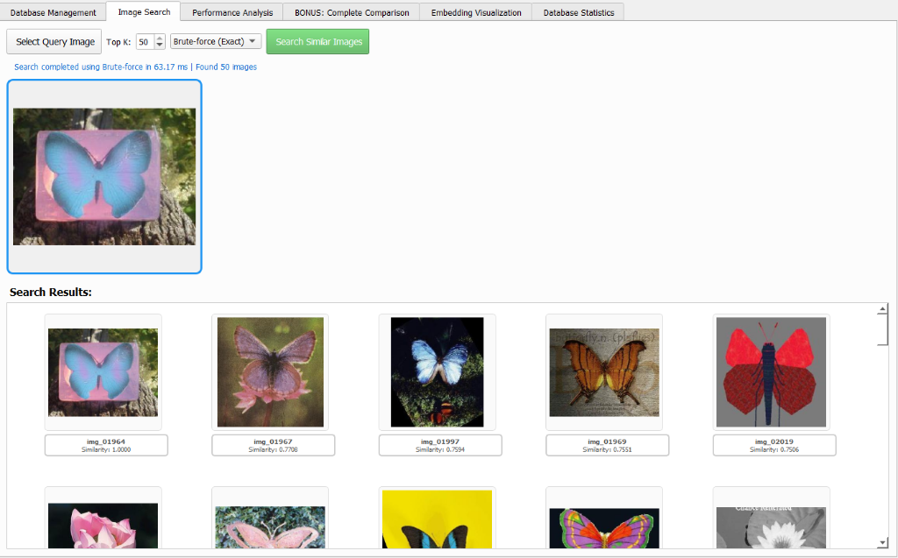
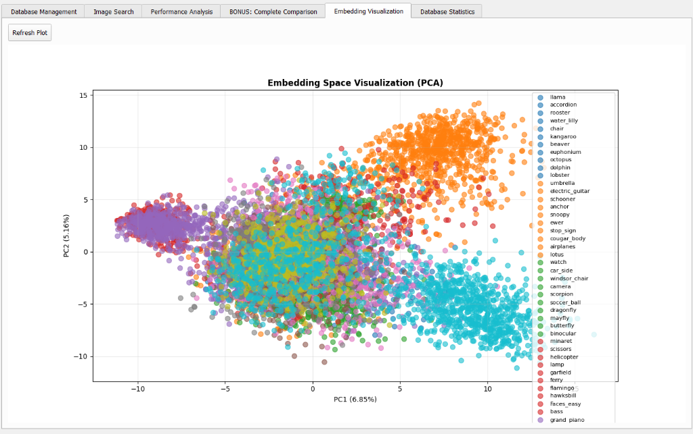
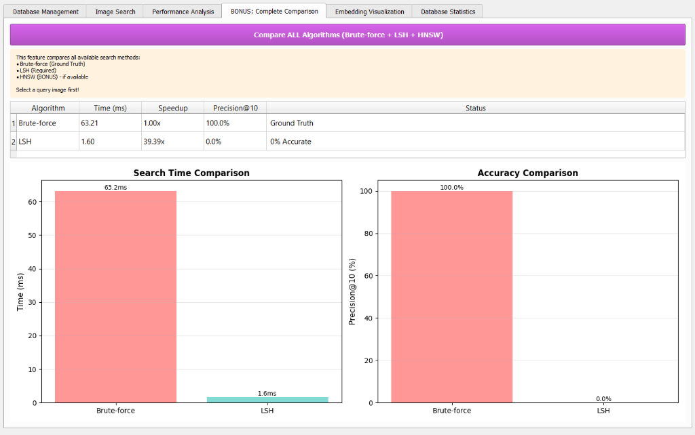

# LSH Image Search (CBIR)

A Content-Based Image Retrieval system implemented in Python for indexing and searching image collections using Locality-Sensitive Hashing (LSH) and Hierarchical Navigable Small World (HNSW) graphs, with deep feature extraction via ResNet-18 and an interactive PyQt5 graphical interface.

## Academic Context

This project was developed as a course project for the Data Structures & Algorithms course at Shahid Beheshti University (SBU).

## Overview

The system retrieves visually similar images from an indexed database without relying on textual labels. It extracts 512-dimensional feature vectors from input images using a pretrained ResNet-18 model, then searches for nearest neighbors using three strategies:

1. Brute-Force (Exact): Vectorized linear scan computing cosine similarity across all stored vectors. Serves as the ground-truth baseline.
2. LSH (Locality-Sensitive Hashing): Multi-table random hyperplane projections mapping vectors into discrete buckets for candidate generation.
3. HNSW (Hierarchical Navigable Small World): A multi-layer proximity graph supporting approximate nearest neighbor search with logarithmic routing.



The project includes an interactive desktop interface (PyQt5) for database management, query visualization, embedding projection (2D PCA), and live performance comparison.

## Architecture

### Feature Extraction (ResNet-18)
Images are resized to 224x224 and normalized using ImageNet channel statistics (mean `[0.485, 0.456, 0.406]`, std `[0.229, 0.224, 0.225]`). A pretrained `torchvision.models.resnet18` extracts features, with the final classification layer (`fc`) replaced by an identity mapping to output a 512-dimensional vector. Each vector is L2-normalized:
$$\|v\|_2 = 1$$

Because vectors are unit-normalized, Euclidean distance and cosine similarity share a monotonic relationship:
$$\|u - v\|_2^2 = 2 - 2 \cos(u, v)$$



### Locality-Sensitive Hashing (`src/core/lsh_index.py`)
The index uses random hyperplane projections for cosine (angular) distance:
- $L$ independent hash tables are maintained.
- Each table defines $k$ projection vectors drawn from a standard normal distribution $\mathcal{N}(0, I_d)$.
- For vector $v$, the $i$-th bit of its hash code is $1$ if $v \cdot r_i \ge 0$, and $0$ otherwise.
- Query complexity:
  $$O(L \cdot k \cdot d + C \cdot d)$$
  where:
  - $L$ is the number of hash tables.
  - $k$ is the number of bits (hyperplanes) per table.
  - $d$ is the vector dimensionality (512).
  - $C$ is the number of unique candidate vectors retrieved from matching buckets across all $L$ tables.
- Candidate count $C$ and search latency depend heavily on the data distribution and parameter configuration ($L$ and $k$). Small $k$ values produce large buckets ($C \approx N$), degrading search time toward a brute-force scan. Large $k$ values produce sparse buckets ($C \to 0$), reducing query latency but increasing the risk of false negatives unless $L$ is increased. Consequently, direct-projection LSH does not provide an unconditional sub-linear performance guarantee.
- Deletions remove the vector ID from its hashed buckets (or perform a full table scan if the vector is not supplied). Updates purge previous bucket placements before re-inserting under new hash codes to avoid duplicate entries.

### HNSW Graph Index (`src/core/hnsw_index.py`)
Implemented as a course bonus feature:
- Builds a multi-layer graph where upper layers have sparse connections for coarse routing, and layer 0 contains local connections bounded by degree parameter $M$.
- Updates: When an existing node ID is updated, the index severs its previous bidirectional connections across all layers before establishing new edges. If the updated node was the graph entry point, a replacement entry point is re-elected from remaining active nodes at the highest available layer.
- Deletions: Managed via tombstone sets in `VectorDatabase`. Candidates returned during graph traversal are filtered against active vectors.
- Exact fallback: To prevent candidate starvation when deletions reduce graph connectivity, the search window scales with the number of deleted vectors (`fetch_k = max(top_k * 2, top_k + deleted_count)`). If graph traversal returns fewer than $\min(N_{\text{active}}, K)$ active results, an exact linear scan over active vectors fills the remaining slots, guaranteeing that requested result counts are satisfied.

### Annoy Prototype (`src/core/annoy_index.py`)
A standalone, pure-Python prototype of random projection bisection trees. It is an independent experimental implementation and is not connected to `VectorDatabase` or the GUI.

## Repository Structure

```text
DS_LSH/
├── README.md
├── docs/
│   └── images/                     # UI screenshots and visualizations
│       ├── search_demo.png
│       ├── benchmark_demo.png
│       └── embedding_pca.png
├── src/
│   ├── main.py                     # Entry point (CLI menu and GUI launcher)
│   ├── inspect_one_image.py        # Database inspection utility
│   ├── core/
│   │   ├── vector_db.py            # Central vector database (thread-safe, LSH and HNSW)
│   │   ├── lsh_index.py            # Multi-table random projection LSH
│   │   ├── hnsw_index.py           # Hierarchical Navigable Small World graph
│   │   └── annoy_index.py          # Standalone Annoy prototype
│   ├── utils/
│   │   ├── image_processor.py      # ResNet-18 feature extraction and preprocessing
│   │   └── visualizer.py           # Benchmark plotting utilities
│   ├── gui/
│   │   └── main_window.py          # PyQt5 user interface
│   ├── scripts/
│   │   └── build_caltech101_db.py  # Ingestion script for Caltech-101 embeddings
│   └── data/
│       ├── caltech101/             # Caltech-101 embeddings and IDs
│       └── embeddings/             # Pickled database files
└── tests/
    └── test_stage1_fixes.py        # Unit and regression test suite (10 tests)
```

## Setup & Dependencies

Supported Python versions: Python 3.10 and 3.11 (tested on Python 3.11 on Windows).

Install dependencies:

```bash
pip install numpy torch torchvision PyQt5 opencv-python Pillow matplotlib tqdm
```

Core libraries:
- `numpy`: Array storage, dot product operations, normalization.
- `torch`, `torchvision`: ResNet-18 feature extraction model.
- `PyQt5`: Desktop interface.
- `opencv-python`, `Pillow`: Image loading and resizing.
- `matplotlib`: Benchmark plots and PCA visualization.
- `tqdm`: Terminal progress bars during batch ingestion.

## Usage

### Interactive CLI Menu
Run without arguments to launch the interactive terminal menu:

```bash
python src/main.py
```

### Desktop GUI
Launch the PyQt5 graphical interface:

```bash
python src/main.py --gui
```

### Headless Pipeline Verification
Generate a synthetic dataset and run index tests without opening the GUI:

```bash
python src/main.py --test
```

### Caltech-101 Dataset Preparation
The Caltech-101 dataset files in `src/data/caltech101/` (`caltech101_embeddings.npy` and `caltech101_image_ids.npy`) contain 9,145 pre-computed embeddings across 102 category folders:
- 101 target object categories: 8,677 images.
- Background clutter category (`BACKGROUND_Google`): 468 images.
- Total indexed count: 9,145 images.

To ingest these pre-computed embeddings into the database file (`src/data/embeddings/caltech101_db.pkl`):

```bash
python src/scripts/build_caltech101_db.py
```

To verify the loaded records and metadata for an individual image:

```bash
python src/inspect_one_image.py
```

## Measured Benchmarks



The following measurements are taken directly from historical execution logs in `src/debug.log`:

### Sample Dataset Search (50 vectors, 5 classes, 512-dim, L=8, k=10)
- Brute-Force Latency: 0.332 ms to 0.334 ms per query.
- LSH Latency: 0.170 ms to 0.332 ms per query.
- Observed Speedup: 1.00x to 1.97x on CPU.
- Precision@5: 53.33% to 73.33%.

Precision definition: In these benchmarks, Precision@5 strictly measures the overlap between LSH results and exact nearest neighbors (i.e., what percentage of the top-5 LSH results match the true top-5 results returned by brute-force cosine search). It does not measure semantic category relevance.

Benchmark scope note: These measurements were recorded exclusively on the 50-vector sample dataset. Performance characteristics, speedups, and recall on the 9,145-vector Caltech-101 dataset have not been formally measured or logged.

### Feature Extraction Throughput
- Ingestion of 801 raw images using ResNet-18 on CPU completed in 61.4 seconds (~13.0 images/second, or ~76.7 ms per image).

## Automated Tests

The test suite in `tests/test_stage1_fixes.py` contains 10 automated unit and regression tests:
- `test_01_lsh_delete_with_vector_and_scan_fallback`: LSH deletion via cached vector hash and fallback scan.
- `test_02_lsh_update_no_duplicate_entries`: Verifies exactly one entry per hash table after vector update.
- `test_03_vector_db_deletion_and_synchronization`: Verifies deletions synchronize across primary storage, metadata, LSH tables, and HNSW graph.
- `test_04_vector_db_update_synchronization`: Verifies update synchronization, metadata update, and stable ID mapping.
- `test_05_dimension_validation`: Enforces dimension checks on insert and search.
- `test_06_core_imports_and_hnsw_availability`: Verifies import resilience and HNSW availability.
- `test_07_hnsw_starvation_after_heavy_deletion`: Verifies search returns requested candidate counts under 90% node deletions.
- `test_08_hnsw_repeated_updates_invariants`: Verifies degree limit ($M$) and 1:1 ID mappings across repeated updates.
- `test_09_save_and_reload_mutated_database`: Tests persistence round-trip after inserts, updates, and deletions.
- `test_10_delete_and_reinsert_same_id`: Verifies clean re-insertion of a previously deleted ID.

Run the test suite:

```bash
python -B -m unittest -v tests/test_stage1_fixes.py
```

## Known Limitations

- Single-machine in-memory storage: Index structures reside in memory and persist via Python pickle, which is suitable for course project scale but not distributed production workloads.
- HNSW deletion overhead: Node deletions use soft tombstoning. While query starvation is mitigated via expanded search windows and exact fallback, accumulated tombstones retain memory until `reindex_hnsw()` is invoked.
- Annoy prototype isolation: The Annoy implementation in `src/core/annoy_index.py` is not integrated into `VectorDatabase` or the GUI.
